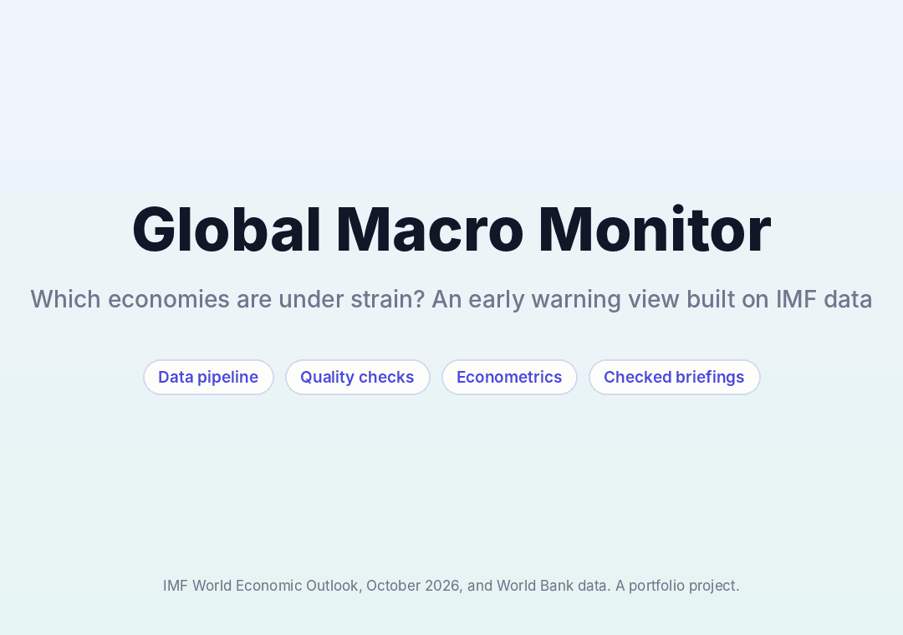

# Global Macro Monitor

An early warning view of 195 economies, built from IMF and World Bank data. It covers the full path an economic research analyst follows: load and check the data, test claims with statistics, score and compare countries, and write briefings in which every number can be traced.

**Live demo:** add your Streamlit link here



## Live demo that never sleeps

`docs/` holds a browser only build of the dashboard (made with [stlite](https://github.com/whitphx/stlite)). The app runs inside the visitor's browser, so there is no server to go to sleep. The first load takes a few seconds while Python starts in the browser. To rebuild after changing the app, run `python web/build_web.py`. It is served with GitHub Pages (Settings, Pages, branch main, folder /docs).

## The question

Which economies show signs of strain, how far can the data be trusted, and what do simple statistics and forecasts say about growth and inflation? The project answers with a dashboard, a set of tested numbers and a clear list of what it cannot show.

## What it does

1. **Builds a database.** The IMF World Economic Outlook (October 2026) and three World Bank series go into one DuckDB file with 122,296 observations, a source registry (file fingerprints and load times) and a table of check results. Every IMF value is marked as an actual or a projection, using the latest actual year the IMF gives for each series.
2. **Checks the data.** Eleven checks run on every load, including a comparison of the IMF and World Bank values for the same country, indicator and year.
3. **Tests claims.** Cross country panel regressions describe what moves with growth. A rolling year by year forecast test compares models against simple baselines.
4. **Scores economies.** Six fixed rules give each country a Low, Elevated or High tier. The score is checked against what happened the following year.
5. **Writes checked briefings.** Facts are computed and formatted first. A writer may only use them. A checker rejects any briefing that cites an unknown fact, uses a number or sign not in the cited facts, claims a cause, presents a projection as a recorded value, or skips a required finding.
6. **Shows it all** in a Power BI style dashboard with slicers, a risk map, a country view, a statistics tab, the quality checks and a limits tab.

## What I found

**Data quality** (11 checks)

| Check | Flagged |
|---|---|
| Duplicates | 0 of 122,296 |
| Implausible values (flagged for review, not deleted) | 181 of 50,016 |
| Gaps inside a series | 9 of 747 series |
| Published growth and inflation against rates computed from published levels | 343 of 15,786 |
| IMF against World Bank, GDP growth (0.5 point tolerance) | 1,048 of 6,531 |
| IMF against World Bank, inflation (0.5 points or 2 percent of the level) | 965 of 6,010 |
| IMF against World Bank, unemployment (1 point, different definitions) | 1,016 of 3,499 |
| Latest actual GDP data more than 3 years old | 8 of 198 countries |

The two sources mostly agree. The median gap is 0.000 points for growth and 0.018 for inflation. A year shift does not explain the differences. About 16 countries differ persistently, for example Bhutan, Uganda, Sierra Leone and the Central African Republic. Unemployment differs more because the IMF reports national definitions and the World Bank reports a modeled estimate on one common definition.

**What moves with growth** (192 countries, 1991 to 2025, actual values only, country and year effects, errors clustered by country)

| Last year's value | Change in growth | 95% interval |
|---|---|---|
| Income, per doubling of GDP per capita | -1.80 points | -2.37 to -1.23 |
| Inflation, per 10 points (capped at 50%) | -0.42 points | -0.75 to -0.09 |
| Government debt, per 10 points of GDP | -0.06 points | -0.10 to -0.01 |
| Budget balance, per 10 points of GDP | +0.42 points | +0.06 to +0.78 |
| Current account, per 10 points of GDP | +0.11 points | -0.07 to +0.30 |

Across six versions of the model (three fixed effects choices, plus dropping 2020 and 2021, dropping extreme years, and starting in 2000), every coefficient keeps its sign, but only income is statistically clear in all six. Inflation is clear in five, budget balance in four, debt in three and the current account in one, so treat debt, budget balance and the current account as fragile. These are associations, not causes. The income effect is probably overstated, because country effects combined with a lagged level are known to bias that estimate (Nickell bias). The direction is reliable, the size is not.

**Forecasts** (next year's growth and inflation, 3,394 and 3,426 country year forecasts, targets 2008 to 2025, each model sees only earlier data)

| Model | Growth error | Inflation error |
|---|---|---|
| Same as last year | 3.64 | 3.10 |
| 5 year average | 3.19 | 3.24 |
| Simple blend | 2.97 | 2.93 |
| Boosting model | 2.81 | 2.86 |

Errors are mean absolute errors in percentage points. The boosting model beats "same as last year" by about 23% for growth. It beats the simple blend by 0.16 points for growth (interval -0.20 to -0.12) and only 0.07 points for inflation (interval -0.12 to -0.01), so the inflation gain is small. No model predicts a shock. In 2020 every model missed growth by about 8 points, and in 2022 every model missed inflation by about 6.

**Early warning tiers** (2025: 15 High, 38 Elevated, 142 Low). The rules are high inflation (over 10%), weak growth (under 1%), high unemployment (over 12%), high government debt (over 90% of GDP), a large external deficit (worse than -5% of GDP) and a large budget deficit (worse than -5% of GDP). A country needs at least four indicators with data to be rated. The thresholds are common rules of thumb, set before looking at outcomes.

Checked against 2000 to 2024, countries in the High tier saw their economy shrink the next year about 20% of the time, against about 12% for Low, and had inflation above 10% the next year about 28% of the time against about 10%. The inflation result is partly persistence. The ranking is stable if thresholds change (rank correlation 0.82 to 0.86), but the tier labels are not: making every threshold 20% stricter moves the High tier from 15 countries to 29, and 25% looser moves it to 7. Use the ranking more than the labels.

**Checked briefings.** In 1,728 deliberately broken briefings (nine kinds of error across 195 countries), the checker caught 1,728. My first version of the checker missed one kind, a projection written up as a recorded value, because the word "projections" in the heading satisfied a simple word check. I then tightened it so that any clause carrying a projected number must itself say it is a projection, and reran the test. That fix was made after seeing the result. The checker still cannot tell whether a true number sits in the right sentence.

## Honest limits

- Associations, not causes. The debt and budget balance results are fragile.
- Forecast scoring uses today's revised data, not the numbers available at the time, and leaves out extreme values (growth beyond 30%, inflation beyond 100%).
- Past IMF forecasts are not scored, because the downloaded file holds only the current edition.
- For many countries the latest years are IMF staff estimates, marked in the country view.
- "Income group" is my own split of countries into quarters by GDP per capita, not the World Bank's official groups. Region comes from a standard country to continent lookup.
- The map file leaves out 31 small states such as Singapore and Malta. They remain in every table and chart.
- The Gemini briefing writer is included but I have not run it against the live service. The checker is the same either way.

## Run it

```
pip install -r requirements.txt
streamlit run app.py
```

The dashboard reads the files in `data/` and `eval/`. To rebuild everything from the original files:

1. Download the data (not stored in this repo) and save as `data/raw/weo.csv` and `data/raw/wdi.csv`:
   - IMF World Economic Outlook, October 2026, full dataset as CSV, from [data.imf.org/datasets/WEO](https://data.imf.org/datasets/WEO).
   - World Bank World Development Indicators from [databank.worldbank.org](https://databank.worldbank.org): GDP growth (annual %), Inflation consumer prices (annual %), Unemployment total (modeled ILO estimate), all countries and aggregates, 1990 to the latest year, as CSV.
2. `pip install -r requirements-dev.txt`
3. `python src/build_db.py`, `python src/regressions.py`, `python src/forecast.py`, `python src/score.py`, `python src/evaluate_briefings.py`
4. `pytest tests`

Refresh is a manual download on purpose. The IMF prohibits bulk downloading by automated means without explicit permission.

## Data and attribution

Source: International Monetary Fund, World Economic Outlook Database, October 2026. The data in this repository have been transformed by this project (reshaped, flagged and scored). IMF terms: [imf.org/en/About/copyright-and-terms](https://www.imf.org/en/About/copyright-and-terms).

World Bank, World Development Indicators, updated 8 October 2026. The world map outline is from the Vega datasets collection (Natural Earth).

## Layout

`src/ingest.py` loading, `src/build_db.py` database, `src/quality.py` checks, `src/panel.py` panel, `src/regressions.py` regressions, `src/forecast.py` forecast test, `src/score.py` early warning score, `src/briefing.py` checked briefings, `src/evaluate_briefings.py` checker test, `src/pbi_view.py` and `app.py` dashboard, `tests/` 26 tests.
